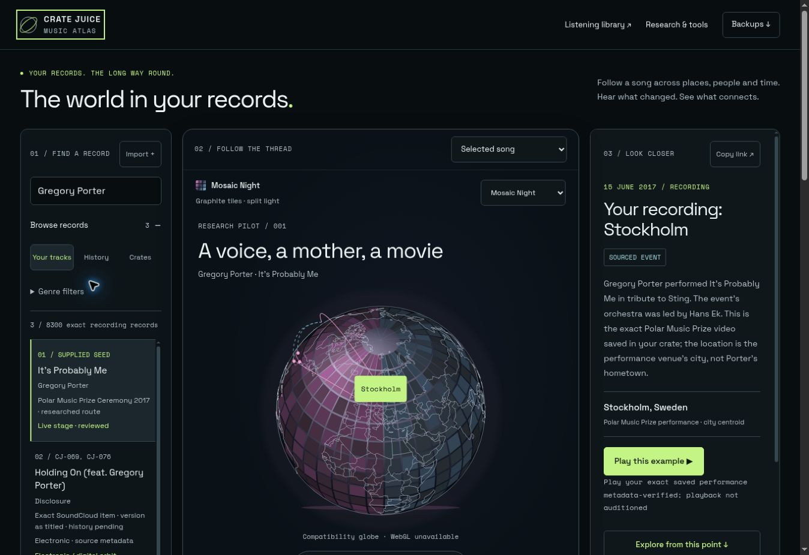
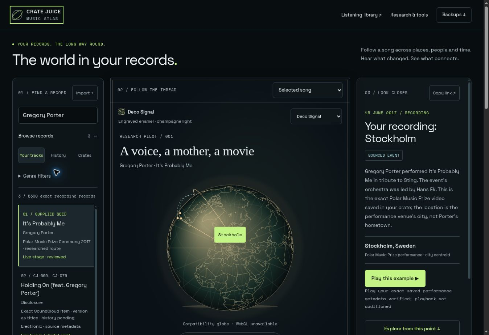
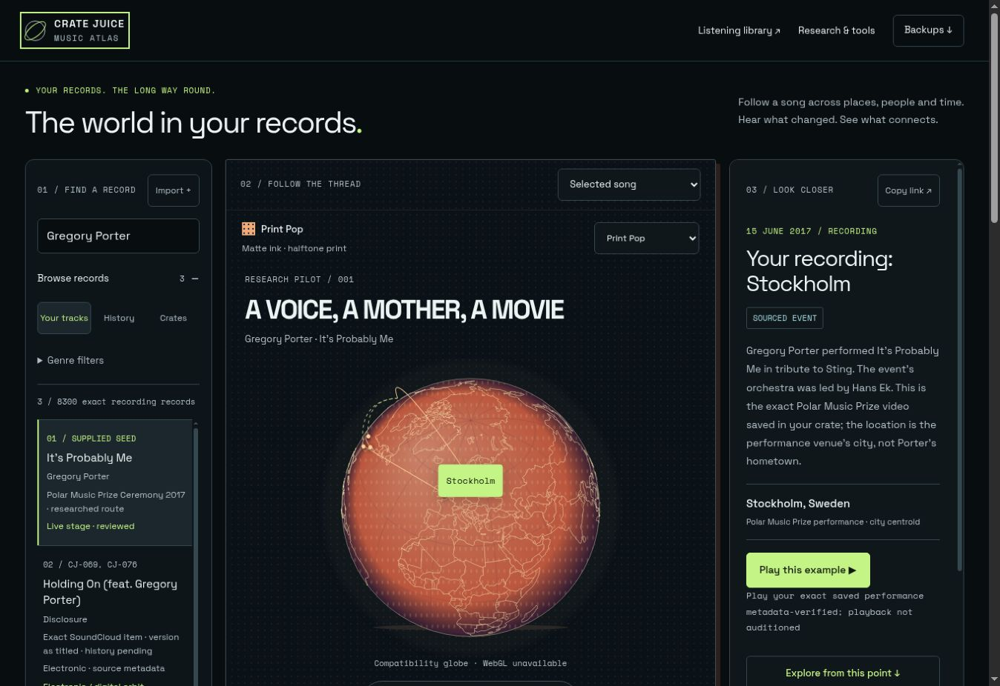

# Music Atlas interface review — 30 October 2026

Branch: `codex/atlas-mosaic-interface`, stacked on draft PR #9 (`8248004`).

A working redesign replaces the application entrance; these are no longer isolated style mockups. The AFTERWORLDS slate/lime reading shell stays fixed while the world changes its material, light, frame and selected heading treatment. Mosaic Night is provisional, with Deco Signal and Print Pop drawn from the existing prototypes. The comparison page and application now share `material-theme.mjs`.

## Working result

[Private review site](https://crate-juice-mosaic-review.xntfsstt5z.chatgpt.site/atlas/) — ChatGPT sign-in required. This is a separate review deployment with the **public catalogue only**, separate browser storage, and no owner overlay or research bootstrap. The everyday Atlas Site is unchanged. Do not treat the review origin as a transfer of existing browser research.

The Sites deployment reported `succeeded` for project `appgprj_6ae386b29c5881918063d87b978190c4`, version 1, deployment `appgdep_6ae3870131b88191b3109788604f6e29`. Its packaged source commit is `2dbeaf4dd6e0fc1c98a565c6e285aa92b096ab62`. The cloud browser reached the expected ChatGPT sign-in gate; authenticated hosted rendering has not been observed. Interaction checks and screenshots below use the local preview of the same application assets.

Application code checkpoint: remote GitHub commit `5b9cb3d2dde6e49e5e87d60ae298e8034e44dda2`, tree `002e267aed1b0af449ce461fb595b3d783f27379`. The GitHub connector tree was checked identical to the tested local tree before committing. The later documentation/screenshots checkpoint does not change deployed application code.

| Mosaic Night | Deco Signal | Print Pop |
| --- | --- | --- |
|  |  |  |

These are real interface screenshots in the **Canvas compatibility renderer**, with one reviewed recording held constant and the surface chosen manually for comparison. They do not demonstrate physical WebGL reflections or establish historical associations between the recording and those visual directions.

## What changed

- Compact introduction; search, globe and detail panel form the main view. Record browsing starts collapsed at compact widths and opens when searching. Genre filters have a labelled disclosure.
- One **Research & tools** disclosure retains the queue/pause control, unresolved topics, concept matching, complete crate import, catalogue coverage, evidence method and prototype comparison. Existing deep links reveal their containing disclosure.
- **Backups** stays in the header. It opens the unchanged PR #9 recovery panel, including its current status labels and validation/recovery behaviour.
- Exact recording specifications and concept inspection are optional disclosures in the detail panel. The verified listening action appears before the exploration action. Source evidence and uncertainty remain available.
- AFTERWORLDS reading/navigation tokens, meta theme colour and control positions remain stable. Globe-only lighting and palettes vary. Original registry notation, groove, cinema and other motifs survive as material variants.
- No full-page era transformations. Visible metadata is at least 11px; explanatory text is generally 12–14px; search/select inputs use 16px where needed to avoid iOS focus zoom. Controls retain at least 44px target height in the checked flows.
- The existing Phong renderer gains procedural mosaic tiles, a small bump scale and two coloured directional lights. No renderer replacement, post-processing, bloom, dependency or data migration was added. The Canvas path projects mosaic tiles onto the same sphere and keeps geographic inputs unchanged.
- Rotation remains opt-in after selecting/focusing a point. Reduced-motion starts paused; changing the system preference to reduced motion pauses an active globe. Paused renderers skip unchanged frames. Rotation, keyboard and pointer state agree with the control label. Renderer listeners are released on disposal.

## Evidence and private boundaries

`ConceptEngine` still decides record fits. Presentation consumes a fit; it does not change it. Pending/ambiguous/conflicting fits and date-only fallbacks use neutral Mosaic Night. Valid scene suggestions remain labelled suggestions; exact reviewed fits and manual choices retain their original evidence/status. A genre, date or nationality alone does not create a historical connection. A manual surface preview does not save a concept choice.

Verified unchanged from PR #9: canonical catalogue, import-source manifest, reviewed history, concept registry, matching algorithms, research engine, backup core/storage/UI, storage schema and private-file ignore rules. No private export, owner playlist contents, live research state or new import was committed or copied into the review deployment.

Public source coverage used here: **258 crates, 9,987 ordered source slots, 8,300 distinct recording identities**. This redesign did not rerun the owner import or recount the private 12,374-slot library. Some local preview browser research was already present; it is not part of the public source or deployment package.

## Validation

```sh
node --test CRATE_MAP/atlas/*.test.mjs
npm ci --prefix CRATE_MAP/atlas/tests --ignore-scripts --no-audit --no-fund
npm test --prefix CRATE_MAP/atlas/tests
```

- **95 Node tests passed**, including all 87 from PR #9, five material/fit tests and three motion/renderer tests.
- **7 recovery-adapter tests passed** with the existing pinned fake-indexeddb fixture. No recovery implementation changed.
- `tests/visual-browser.html`: **41/41** baseline acceptance checks; **42/42** with synthetic reduced motion; **42/42** with synthetic reduced motion plus all canvas unavailable.
- Checked iframe viewport widths: **320, 390, 768, 1024 and 1440px**. No document horizontal overflow. Checked search text size, world bounds, consistent frame geometry, stable shell colours/type, all surface choices, search/selection, source/playback entry points, concept inspector, advanced controls, Backups open/close and focus return, modal accessible names, target heights and visible label size.
- Mocked renderer lifecycle tests verify that paused Canvas frames stop drawing, zoom invalidates a frame, reduced-motion changes pause the renderer, and listeners are cleaned up. Both renderer classes share the checked pause event behaviour.
- JavaScript syntax and `git diff --check` passed. Reading/action token contrast is covered by the existing AA contrast tests; this is not a full accessibility certification.

The iframe harness uses the actual app HTML/modules. Its synthetic reduced-motion shim exercises renderer behaviour; it does **not** emulate native Safari CSS/media settings, device safe areas, thermal limits or touch hardware. Its srcdoc fixture suppresses URL updates; actual local-preview selection and query updates were checked separately. The harness pauses research through the normal UI control and performs no import or restore.

## Still to verify — resumable queue

1. Physical Safari on iPhone, iPad and Mac: native reduced-motion changes, 200% text/zoom, VoiceOver, touch drag/pinch, safe areas, source playback and long-title details.
2. WebGL material rendering and the Canvas fallback after WebGL failure on real hardware. Measure battery/thermal behaviour before increasing texture size, geometry or lighting. Current appearance is procedural Phong shading, not physical mirror reflections.
3. Keep PR #9's independent recovery/privacy review and physical HTTPS save/check/rehearse/restore acceptance outstanding. The HTTP cloud preview cannot exercise Web Crypto; the new interface tests only open that panel.
4. Review/merge PR #9 separately, then the stacked interface change. Deploy to the everyday owner-private Site only after its original gate is satisfied, preserving its private overlay, source bootstrap, Site identity and audience. **No main-branch merge or everyday Atlas deployment has occurred.**

To reproduce locally, serve the repository's `CRATE_MAP` directory on trusted localhost and open `/atlas/` or `/atlas/tests/visual-browser.html`. Use synthetic fixtures for recovery tests; keep owner files outside the public repository.
